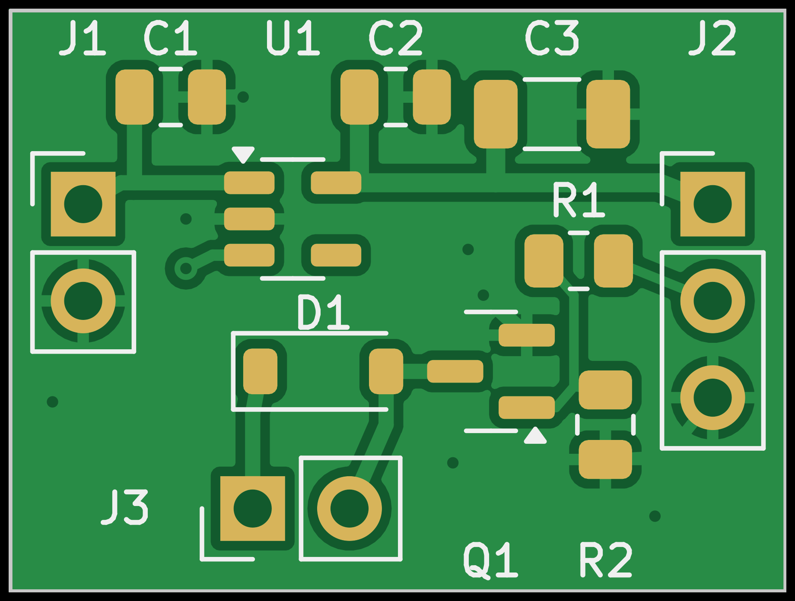

# BluControl-ESP32: Dreamcast & GameCube

Wireless mods for original retro controllers, built on [BluControl-ESP32](https://github.com/JPZV/BluControl-ESP32) by JPZV.

An ESP32 is placed inside the controller and reads it the way the console would. The controller's own board is kept intact. The ESP32 then talks Bluetooth, either as a **Nintendo Switch Pro Controller** or as a generic gamepad for **[BlueRetro](https://github.com/darthcloud/BlueRetro)** adapters.

This fork only keeps what these controllers need. For the other controllers supported by BluControl (N64, SNES, NES, PSX…), use the [original project](https://github.com/JPZV/BluControl-ESP32).

## Controllers

| Controller | Status | Page |
|---|---|---|
| **Sega Dreamcast** | ✅ v1: buttons, stick, analog triggers, and the **VMU** (saves and screen) through a modified BlueRetro, with 4 VMU pages (800 blocks) | [docs/dreamcast.md](docs/dreamcast.md) |
| **Nintendo GameCube** | 🚧 Coming: version 1 in Yakara's style with rumble, and version 2 "cable mode" with the controller board kept intact | [docs/gamecube.md](docs/gamecube.md) |

Ready-to-flash firmware is in the [Releases](../../releases).

## The BluPower GC board



A small board (20.3 × 15.2 mm) made for this project:
- an AP2112K low-dropout 3.3 V regulator for the ESP32, which keeps working as the LiPo battery runs down, where the usual AMS1117 cannot;
- a MOSFET that drives the GameCube rumble motor.

It is fully populated for the GameCube version 1. The Dreamcast and the GameCube cable mode only use its regulator. KiCad project, Gerbers and JLCPCB files are in [`hardware/blupower_gc/`](hardware/blupower_gc). Parts, wiring and ordering: [docs/blupower.md](docs/blupower.md).

## Repository layout

| Path | Content |
|---|---|
| `blu-common/` | Shared components. Dreamcast Maple bus driver: `dc_maple.c` |
| `blu-switch/` | Switch Pro Controller mode |
| `blu-generic/` | BLE gamepad mode for BlueRetro, including the VMU service |
| `blu-ota/` | Wi-Fi update mode |
| `configs/` | Build configuration per controller |
| `patches/` | Small changes to JPZV's submodules, applied by `build.sh` |
| `blueretro/` | Patch for BlueRetro v25.04 (Dreamcast VMU support) |
| `hardware/` | BluPower GC board (KiCad, Gerbers, JLCPCB files) |
| `docs/` | Documentation |

## Building

Requires **ESP-IDF v5.0** and Node.js (for the update web page).

```sh
git clone --recursive https://github.com/romquenin/BluControl-ESP32
cd BluControl-ESP32
. $IDF_PATH/export.sh
./build.sh dreamcast
```

The script applies the patches, builds the three modes, and writes two files to `release/`:
- `BluControl_dreamcast_FULL_0x0.bin`: full USB flash at address 0x0;
- `BluControl_dreamcast.updpkg`: Wi-Fi update.

The modified BlueRetro is built separately: see [blueretro/README.md](blueretro/README.md).

## Credits

- **[JPZV](https://github.com/JPZV)**, author of [BluControl-ESP32](https://github.com/JPZV/BluControl-ESP32), which this project is built on, and of the forks it uses: [BluControl-SDK-ESP32](https://github.com/JPZV/BluControl-SDK-ESP32), [HOJA-LIB-ESP32](https://github.com/JPZV/HOJA-LIB-ESP32), [ESP32-BLE-Gamepad-idf](https://github.com/JPZV/ESP32-BLE-Gamepad-idf), [esp-nimble-cpp](https://github.com/JPZV/esp-nimble-cpp).
- The original authors of those libraries:
  - **HandHeldLegend**: HOJA-LIB-ESP32, the Switch Pro Controller emulation;
  - **[lemmingDev](https://github.com/lemmingDev)**: ESP32-BLE-Gamepad;
  - **[h2zero](https://github.com/h2zero)**: esp-nimble-cpp.
- **[darthcloud](https://github.com/darthcloud)**: [BlueRetro](https://github.com/darthcloud/BlueRetro). The Dreamcast VMU support is a patch on BlueRetro v25.04.
- **[dpedu.io](https://dpedu.io/article/2015-03-11/nintendo-64-joystick-pinout-arduino)**: credited by the original BluControl for his article on N64 analogs.
- **[Yakara](https://github.com/yakaracolombia)**: for the GameCube wireless mod that inspired our GameCube work.

## License

Same license as BluControl-ESP32: [CC BY-NC-SA 4.0](LICENSE). Non-commercial use only, with attribution, and derivatives must be shared under the same license. Submodules and the BlueRetro patch keep their own licenses: GPL-3.0 for BluControl-SDK, CC BY-NC-SA 4.0 for HOJA-LIB, MIT for ESP32-BLE-Gamepad, Apache-2.0 for esp-nimble-cpp and BlueRetro.

Maintained by [romquenin](https://github.com/romquenin).
