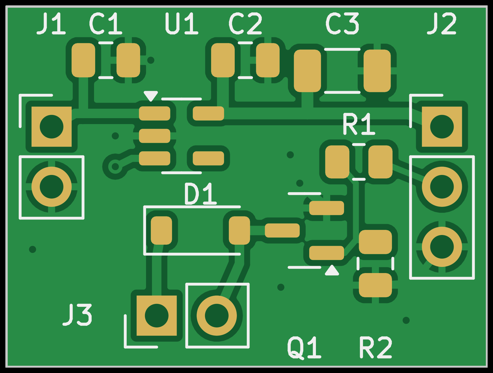
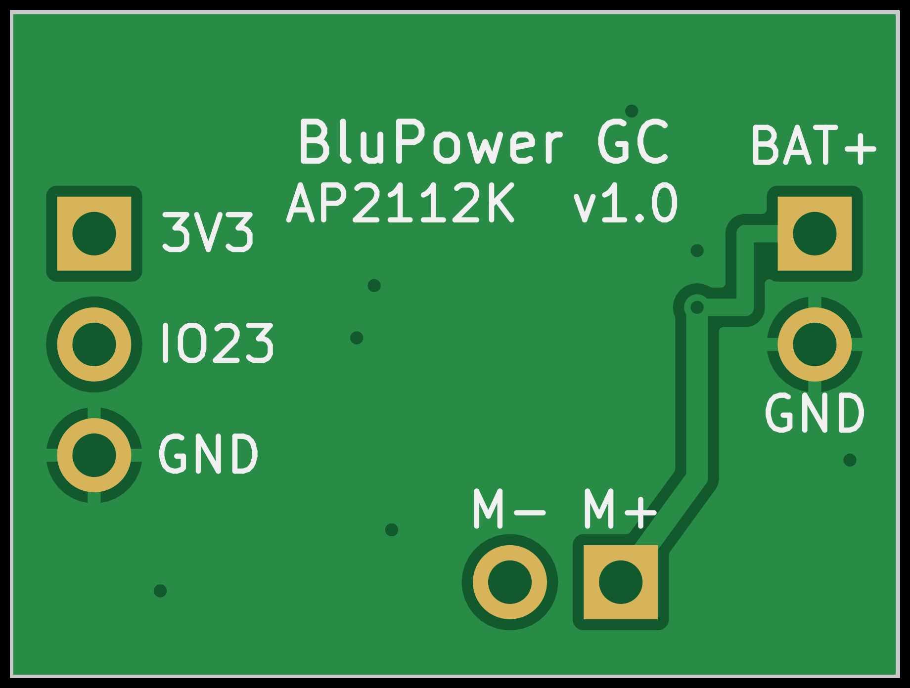
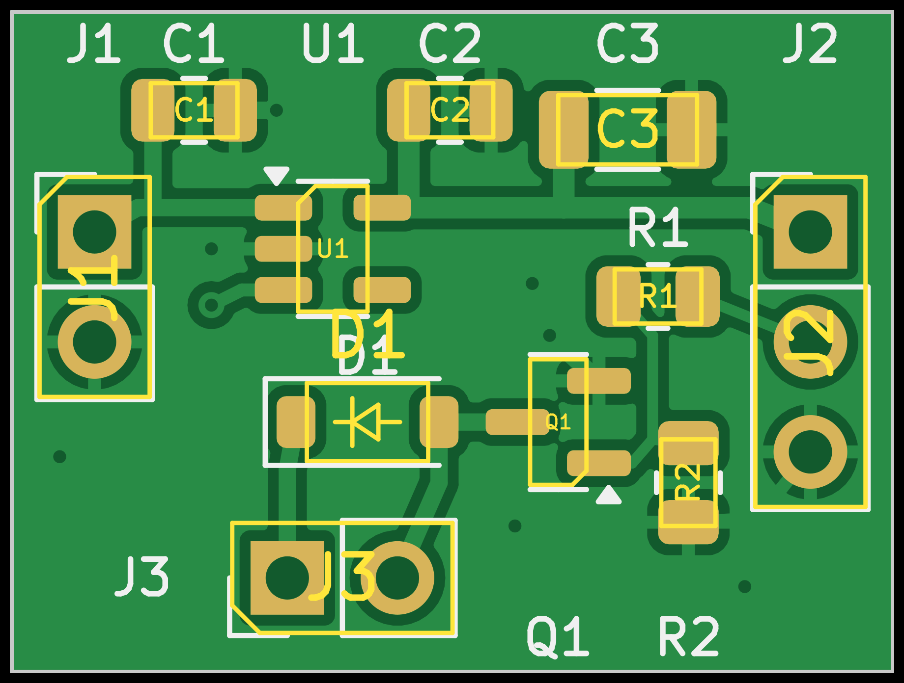
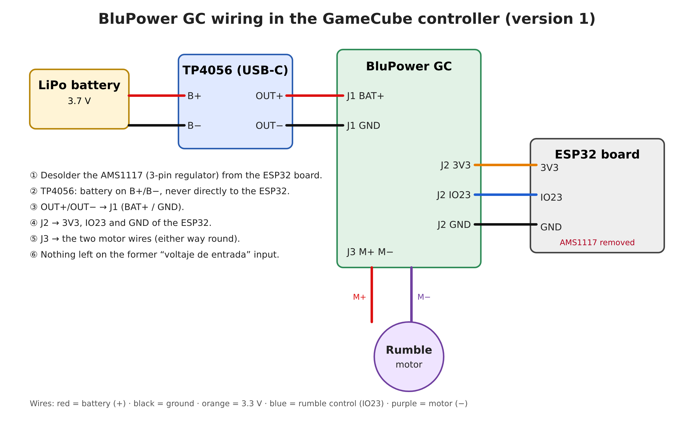

# BluPower GC board

A small board (20.3 × 15.2 mm) made for this project. It does two things:

1. **A real 3.3 V for the ESP32 on battery.** It replaces the AMS1117 of the ESP32 board with an **AP2112K-3.3**. The AP2112K drops only about 0.25 V, against about 1.1 V for the AMS1117. On a LiPo battery, the ESP32 finally gets a proper 3.3 V, which fixes the Bluetooth disconnections.
2. **Drives the GameCube rumble motor** from the battery, through a MOSFET controlled by the ESP32's GPIO23. Rumble also needs the BluControl firmware from this repository.

| Front | Back |
|---|---|
|  |  |

## Parts (LCSC / JLCPCB)

| Ref | Value | Package | LCSC | Role |
|---|---|---|---|---|
| U1 | AP2112K-3.3TRG1 | SOT-23-5 | C51118 | 3.3 V 600 mA low-dropout regulator |
| C1 | 10 µF 25 V | 0805 | C15850 | regulator input |
| C2 | 22 µF 25 V | 0805 | C45783 | regulator output |
| C3 | 100 µF 6.3 V | 1206 | C15008 | reservoir for Bluetooth and motor current peaks |
| Q1 | AO3400A | SOT-23 | C20917 | motor switch |
| D1 | B5819W | SOD-123 | C8598 | motor flyback diode |
| R1 | 100 Ω | 0805 | C17408 | gate resistor |
| R2 | 10 kΩ | 0805 | C17414 | keeps the motor off at boot |

J1, J2 and J3 are 2.54 mm holes for soldering wires directly. They are not assembled.

## Which parts to solder

| Build | Parts |
|---|---|
| [GameCube](gamecube.md) version 1 (Yakara style, with rumble) | **all** |
| [GameCube](gamecube.md) version 2 (cable mode) | regulator only: **U1, C1, C2, C3**, plus an external 5 V boost |
| [Dreamcast](dreamcast.md) | regulator only: **U1, C1, C2, C3**, plus an external 5 V boost |

## Pinout

| Connector | Pin | Connect to |
|---|---|---|
| J1 | BAT+ | TP4056 OUT+ (after the on/off switch, if any) |
| J1 | GND | TP4056 OUT− |
| J2 | 3V3 | 3V3 pin of the ESP32 |
| J2 | IO23 | GPIO23 of the ESP32 (rumble control) |
| J2 | GND | GND of the ESP32 |
| J3 | M+ / M− | the two rumble motor wires (either way round) |

## Wiring (GameCube, version 1)

- **Desolder the AMS1117** from the ESP32 board: the 3-pin regulator with a tab, marked AMS1117 3.3. Leave its input unconnected.
- Without the AMS1117, the ESP32 board's USB port no longer powers it. To flash over USB, the battery must be connected and the controller switched on.

## Checks after assembly

- With a full battery: **3.28–3.32 V** between 3V3 and GND.
- 3V3 must stay above 3.2 V while the battery goes down to 3.6 V.

## Ordering from JLCPCB

All files are in [`hardware/blupower_gc/`](../hardware/blupower_gc):
- Gerbers: `fab/BluPower_GC_gerbers_JLCPCB.zip`;
- assembly: BOM `fab/BOM_JLCPCB.csv` and placement `fab/CPL_JLCPCB.csv`;
- the board is larger than 10 × 10 mm, so it can be assembled on its own;
- in JLC's placement preview, check the orientation of U1, Q1 and D1 (the diode's band on the M+ / BAT+ side).

The KiCad project (KiCad 7 format, opens in KiCad 8 and 9) includes its libraries. DRC: 0 violations, schematic and PCB netlists match. `BluPower_GC_schematic.pdf` is the schematic, and `tools/` holds the scripts that generated the board.
