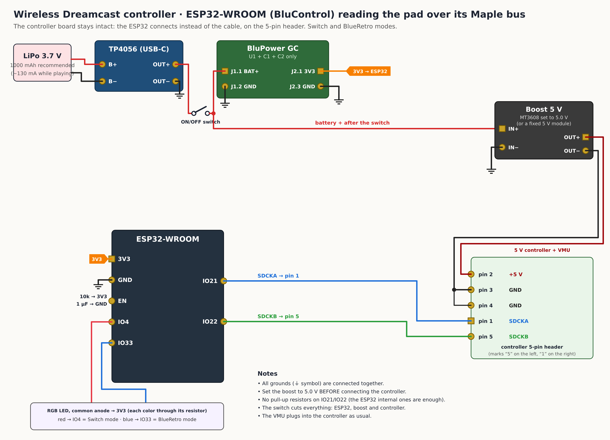
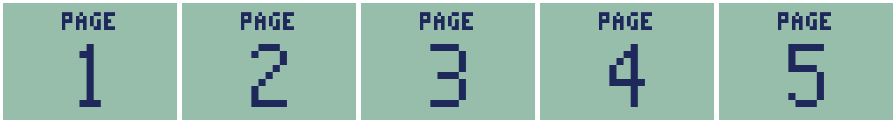

# Wireless Dreamcast controller (with VMU)

An original Sega Dreamcast controller made wireless with an ESP32. The controller board is not modified: the ESP32 connects to the controller's 5-pin header, in place of the cable, and reads the controller over its **Maple bus**, like the console does.

Two modes:
- **Switch mode**: the controller is seen as a Nintendo Switch Pro Controller.
- **BlueRetro mode** (on a Dreamcast): all buttons, stick and analog triggers, plus the **VMU plugged into the controller**, with saves and screen. This requires the modified BlueRetro from this repository on the console side.

Tested on real hardware (November 2026):
- buttons, stick and triggers;
- VMU screen (BIOS, openMenu, game logos);
- saves written back to the real VMU;
- openMenu, file deletion and BIOS formatting;
- 4 VMU pages, with saves in Jet Set Radio and Capcom vs. SNK 2 on every page.

## Downloads

From the [Releases](../../releases):

| File | Where |
|---|---|
| `BluControl_Dreamcast_v1.updpkg` | Controller, Wi-Fi update |
| `BluControl_Dreamcast_v1_FULL_0x0.bin` | Controller, first install or recovery over USB, at address **0x0** |
| `BlueRetro_HW2_Dreamcast_VMU_v1.bin` | BlueRetro HW2 (internal Dreamcast version), OTA update from blueretro.io |

## Hardware

| Part | Notes |
|---|---|
| ESP32-WROOM module | |
| LiPo 3.7 V battery + TP4056 charger (USB-C) | about 130 mA while playing; 1000 mAh or more recommended |
| 3.3 V regulator (we used a BluPower GC board, only its regulator U1 with C1 and C2; any 3.3 V LDO works) | powers the ESP32 |
| 5 V boost (MT3608 or fixed 5 V module) | powers the controller and the VMU (Maple devices expect 5 V) |
| ON/OFF switch | cuts everything |
| RGB LED, common anode | red on IO4 = Switch mode, blue on IO33 = BlueRetro mode |
| 22 µF between 3V3 and GND, close to the module | avoids a brownout when Bluetooth starts |
| 10 kΩ EN → 3V3 and 1 µF EN → GND | clean reset |

**Controller header** (marks "5" on the left, "1" on the right):

| Pin | Signal | Connect to |
|---|---|---|
| 1 | SDCKA | IO21 |
| 2 | +5 V | boost output |
| 3 | GND | GND |
| 4 | GND | GND |
| 5 | SDCKB | IO22 |

No pull-up resistors are needed on IO21/IO22. Set the boost to 5.0 V **before** connecting the controller.

## Installing

**Controller:**
- First install: flash `BluControl_Dreamcast_v1_FULL_0x0.bin` at **0x0** over USB. With Espressif's Flash Download Tool, use ESP32, 40 MHz and DIO.
- Later updates over Wi-Fi:
  1. Hold **Start + A** while switching the controller on, and keep holding for 2 s.
  2. Join the controller's Wi-Fi network.
  3. Open http://192.168.4.1 and send the `.updpkg`.

**BlueRetro (console side):**
1. On [blueretro.io](https://blueretro.io), open **BlueRetro OTA FW update** and send `BlueRetro_HW2_Dreamcast_VMU_v1.bin`.
2. Switch the console off and on again.

The version shown on blueretro.io then starts with `v25.04-dc-v1`.

The modified BlueRetro behaves like the official one with any other controller. Only a BluControl Dreamcast controller with a VMU triggers the VMU features.

## Using it

| Action | How |
|---|---|
| Power on / off | switch |
| Change mode | hold **Start + A** for 5 s (red LED = Switch, blue LED = BlueRetro) |
| Wi-Fi update | hold **Start + A** while switching on, keep 2 s |
| Recovery | if the controller cannot be read for 20 s, update mode starts by itself |
| Pair again with BlueRetro | hold **X + Y** while switching on |
| Next / previous VMU page | hold **Start + Y** / **Start + X** for 4 s (any controller) |

**Switch mode mapping**, by button position:
- A → B, B → A, X → Y, Y → X;
- triggers → ZL / ZR;
- Start → +, Start + X → Home, Start + Y → −.

### LEDs in BlueRetro mode

| LED | Meaning |
|---|---|
| Red and blue for 2–4 s at power-on | the controller is copying its VMU |
| 3 quick blue blinks | BlueRetro received the copy |
| Red while playing | a save is being written to the VMU: **do not switch off** |
| Red/blue blinking | error (copy, or writing a block) |

## The VMU

1. At power-on, before Bluetooth starts, the controller reads its whole VMU (128 KB) and keeps a copy in the ESP32 flash.
2. When it connects, BlueRetro receives that copy through an extra Bluetooth service and shows it to the Dreamcast as the controller's VMU.
3. Every block the Dreamcast writes is sent back to the controller. The controller writes it to the real VMU, reads it back to check it, and updates its copy.
4. The VMU screen is forwarded to the real VMU.

BlueRetro also has its own internal VMU, used with any other controller (or an arcade stick).
- When the Dreamcast controller connects with its VMU, **page 1 of the internal VMU becomes a mirror of the real VMU**. Every save then goes to both.
- With another controller, the Dreamcast uses the internal VMU, so it sees the latest saves too.
- **Warning:** saves made with another controller only go to the internal VMU. The next time the Dreamcast controller connects with its VMU, page 1 is **overwritten** by the real VMU. To keep them, copy them to the real VMU first, with the console's file manager and a wired controller.

### 4 pages (800 blocks)

BlueRetro keeps **4 VMUs of 200 blocks**. The Dreamcast sees one at a time, like a 4X memory card.

| Page | Content |
|---|---|
| 1 | mirror of the Dreamcast controller's real VMU |
| 2–4 | virtual VMUs, stored only in BlueRetro |

- **Changing page**: hold **Start + Y** (next) or **Start + X** (previous) for 4 s, on any controller. After page 4 comes page 1.
- The VMU disappears for about a second, then comes back with the other page. The controller's VMU screen shows **"PAGE n"** until the console redraws it. Change pages in the Dreamcast menu or in openMenu, **before starting a game**.
- The console always starts on page 1. When the Dreamcast controller connects with its VMU, BlueRetro goes back to page 1.
- A new page is unformatted: accept the format offered by the console (file manager), once per page.
- The VMU screen works on every page while the Dreamcast controller is connected.
- The **DC VMU manager** of blueretro.io reads and writes the **current page**. Use it with the Dreamcast controller switched off.

A 5th page was tried: BlueRetro's file system (SPIFFS, 960 KB) cannot hold it reliably.

### Diagnostic line

On blueretro.io, the version is followed by a diagnostic, for example `v25.04-dc-v1 R1 p1 F60 nolog`:
- **R**: reason of the last BlueRetro restart. 1 = normal power-on, 4 = software crash, 5–7 = watchdog, 9 = brownout.
- **p**: current VMU page.
- **F**: BlueRetro file system used, in %.
- **The rest**: a crash recorder, showing what BlueRetro was doing just before its last restart. `nolog` means nothing to report. After a crash, **keep the console powered** until you have read the line, since a power cut clears the record.

### Limits

- The VMU clock is not forwarded.
- The VMU is copied when the controller is switched on. To change VMU, switch the controller off and on.
- A 5 V boost is recommended. Without it, the controller and VMU run from the battery voltage, which becomes unreliable as the battery gets low.

## Notes for builders

- In this BlueRetro build, the power-sense input (IO39) is ignored. In the console, the ESP32 is only powered while the console is on.
- BlueRetro runs the Maple bus on the ESP32's second core, which can only execute code from RAM. Any function called while handling a console write must stay in IRAM. A function placed in flash by the compiler crashed BlueRetro on every write during development.
- Sources: `blu-common/blu-components/dc_maple.c` (Maple bus and VMU, controller side), `blu-generic/main/main.cpp` (Bluetooth VMU service), `blueretro/` (console side).
